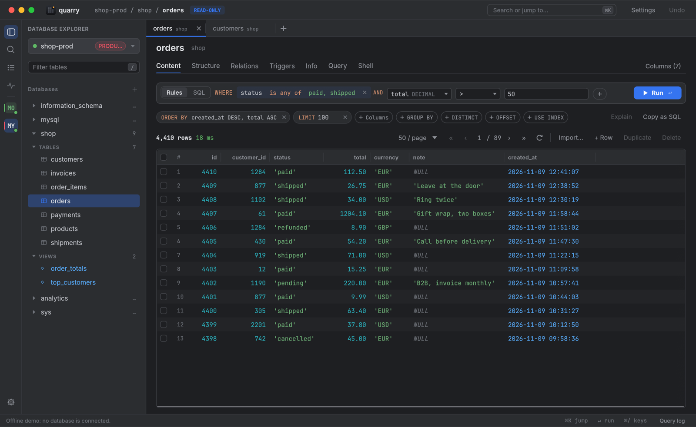
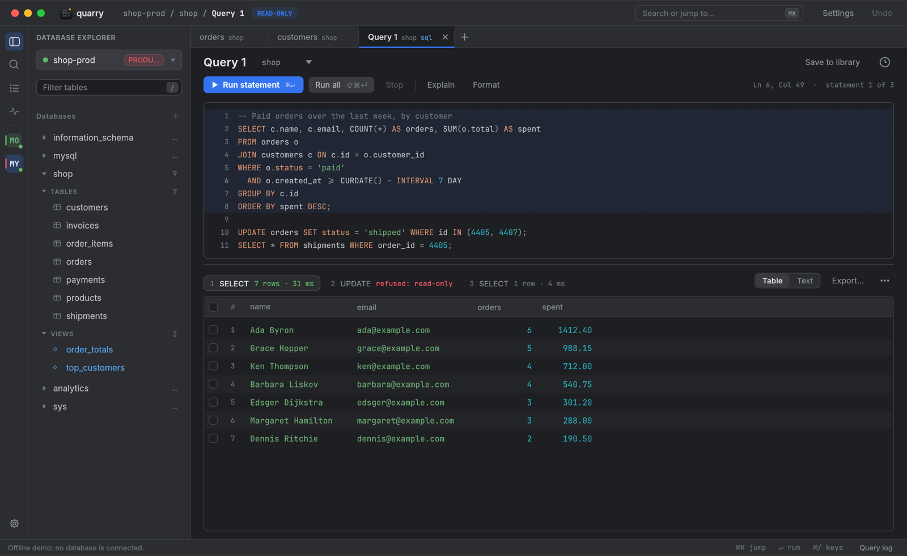
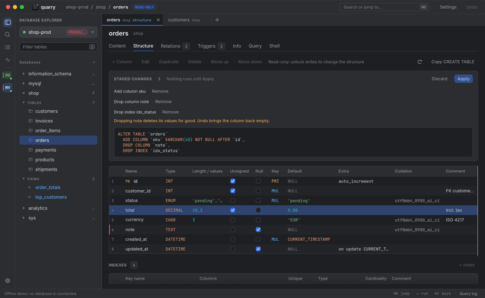
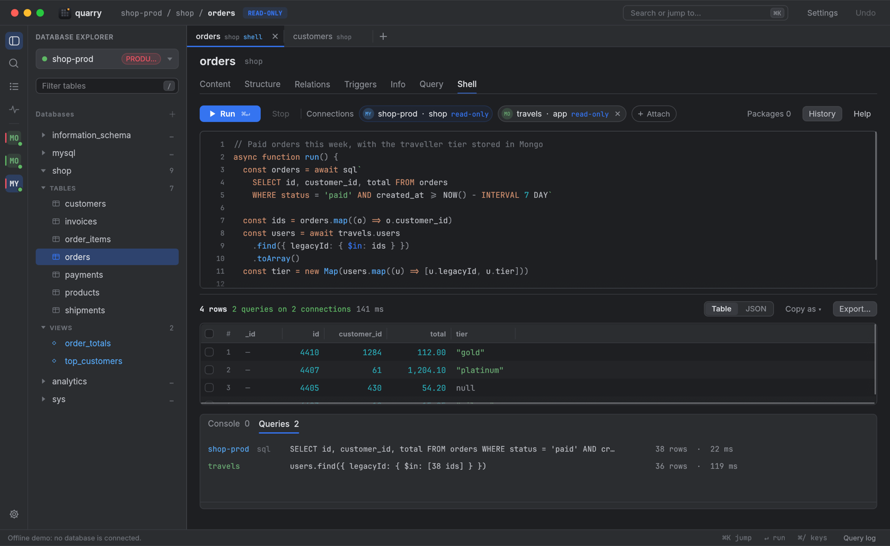
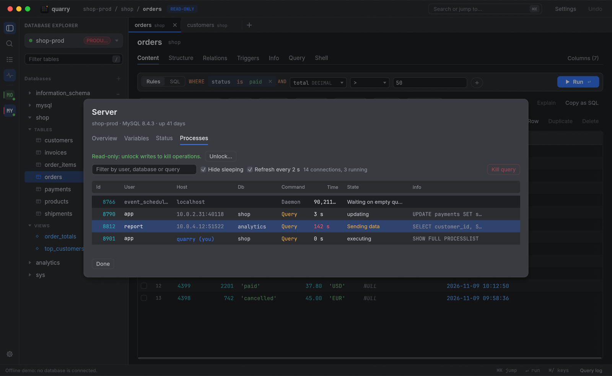

<p align="center"></p>

<h1 align="center">Quarry</h1>

<p align="center">A fast, stable and full-featured client for MongoDB, MySQL and MariaDB, written in Rust with egui.<br>Inspired by <a href="https://mingo.io">Mingo</a>.</p>


## Features

**One app for every database**
- MongoDB, MySQL (5.7, 8.x, 9.x) and MariaDB (10.6+) side by side, in tabs with a table or JSON view.
- Open connections sit in the rail and come back when Quarry starts. Cmd+K jumps to any collection or table, Cmd+/ shows every shortcut (Ctrl on Linux and Windows).

**Edit without worrying**
- Every connection opens read-only until you unlock it.
- Edits are staged, saved together and can be undone, and Quarry won't overwrite a change someone else made meanwhile.
- Bulk updates, structure changes and drops show exactly what they will run first.

**Query**
- MongoDB: paste `db.orders.find(...)` or `aggregate([...])`, type `#today` or `#last2months`, build a pipeline one stage at a time with a preview after each, read explain plans, copy as driver code.
- SQL: filter a table with typed rules or plain SQL. The Query editor runs several statements at once, with autocomplete for tables, columns and values, Format, Explain and Stop.
- Keep the queries you reuse in a library, and get older ones back from the history.
- See every command and statement sent, with its duration and errors, in the query log (Cmd+L). Passwords never show.

**Script it**
- A JavaScript shell on [Bun](https://bun.sh), with npm packages and autocomplete: the official driver for MongoDB, `` sql`...` `` templates and typed tables for SQL. Attach other connections to read MongoDB and SQL in one script.

**Shape your data**
- MongoDB: see which indexes are used and get suggestions, create them with every option, see each field's types, write validators, follow references to the document they point to, and watch changes live.
- SQL: edit columns, indexes, foreign keys and triggers through a previewed ALTER, click a foreign key to open its row, and create or drop databases and tables.

**Move data around**
- MongoDB: import and export JSON, CSV or TSV, compare and sync two collections, dump and restore with the Database Tools (installed for you).
- SQL: import CSV and SQL dumps, and export streamed SQL dumps (gzip optional) or any Copy as format.

**Run the server**
- Health, status, variables and running operations, with Kill for the slow ones, and users, roles and privileges.

**Connect from anywhere**
- SSH tunnels (password, key file or agent), SOCKS5 proxies, and TLS.
- Passwords stay in your system keychain: the macOS Keychain, Windows Credential Manager, or the Secret Service on Linux.
- Tag connections as Production, Staging or anything you like, so you always know which one you're on.

| | |
|---|---|
|  |  |
|  |  |
|  |  |
|  |  |
|  |  |

## Install

Download the latest build for your system from [Releases](https://github.com/alkanna/quarry/releases).

**macOS** (Apple silicon, Intel, or universal): unzip `Quarry-macos-*.zip` into Applications. The app is not notarized, so run `xattr -dr com.apple.quarantine /Applications/Quarry.app` once.

**Linux** (x86_64 and ARM64): extract `quarry-linux-*.tar.gz` and put the `quarry` binary somewhere on your `PATH`, such as `~/.local/bin`. It needs GTK 3 and xkbcommon (`sudo apt install libgtk-3-0 libxkbcommon0` on Debian and Ubuntu) and either `libwayland-client0` or the X11 libraries (`libx11-6 libxcursor1`). On NixOS, add wayland, libxkbcommon, libGL, vulkan-loader and gtk3 to `programs.nix-ld.libraries` (or set `LD_LIBRARY_PATH`), and a Secret Service provider such as GNOME Keyring or KWallet to store passwords.

**Windows** (x86_64 and ARM64): unzip `quarry-windows-*.zip` and run `quarry.exe`. The binary is not signed, so SmartScreen may warn the first time: choose More info, then Run anyway.

Quarry then updates itself: it checks for new releases shortly after launch and once a day, installs them in the background, and restarts once you have been idle for a minute with nothing unsaved. It shows what's new after an update. You can turn updates off in Settings.

## Build

Needs Rust (stable). The Shell needs [Bun](https://bun.sh), and MongoDB dump/restore needs the [MongoDB Database Tools](https://www.mongodb.com/docs/database-tools/), which Quarry can install for you. Quarry finds both automatically, or you can set their paths in Settings.

```sh
cargo run --release      # run it
./bundle.sh              # package for this machine into dist/
./bundle.sh linux-x86_64 # or for a given platform (./bundle.sh --help lists them)
cargo test               # run the tests
```

### Stop the Keychain prompts on macOS

Every build gets a new ad-hoc signature, so macOS treats it as a new app and asks for your password again for each saved connection. `cargo run` signs the build with a certificate named `Quarry Dev` when it finds one (see `.cargo/run-signed.sh`), which keeps the signature stable across rebuilds. To create it once:

1. Open Keychain Access and choose **Keychain Access > Certificate Assistant > Create a Certificate**.
2. Name it `Quarry Dev`, set Identity Type to **Self Signed Root** and Certificate Type to **Code Signing**, and click Create.
3. Run `cargo run`, then click **Always Allow** at each prompt. Later builds won't ask again.

Without the certificate, `cargo run` prints a warning and runs the build unsigned.

`quarry --screenshot out.png` draws the offline demo, saves a picture and exits. It never connects to a database.

## Releasing

Commits to `master` follow [Conventional Commits](https://www.conventionalcommits.org) (`feat:`, `fix:`, ...). [release-please](https://github.com/googleapis/release-please) keeps a release PR open; merging it tags the version and the release workflow attaches the builds. In the repository settings, under Actions > General, allow GitHub Actions to create pull requests.

## License

MIT, see [LICENSE](LICENSE).
