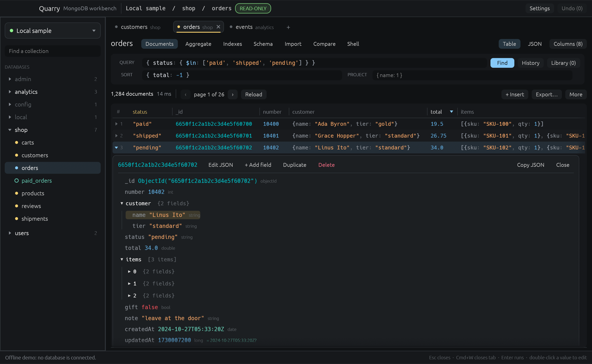
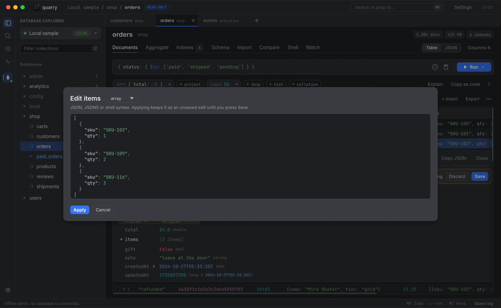
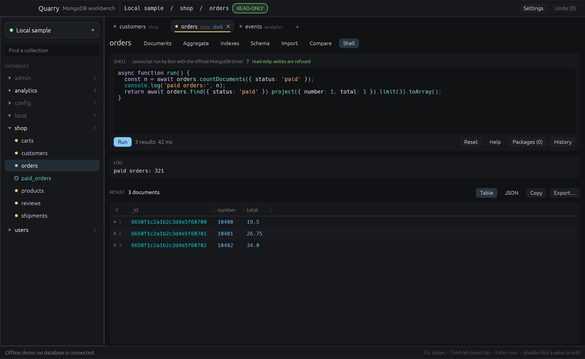
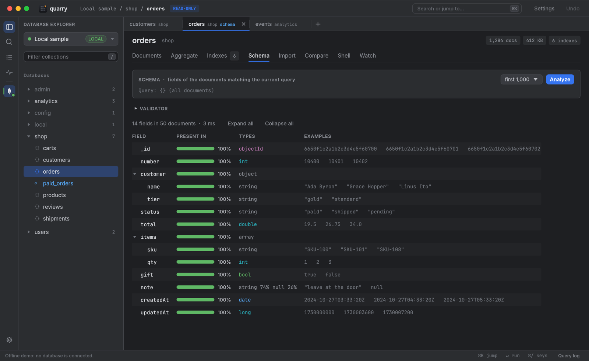
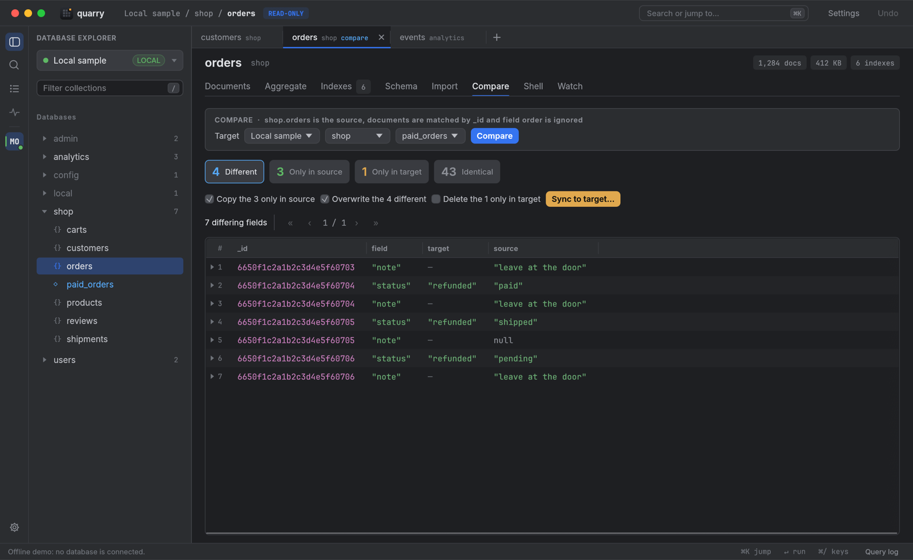
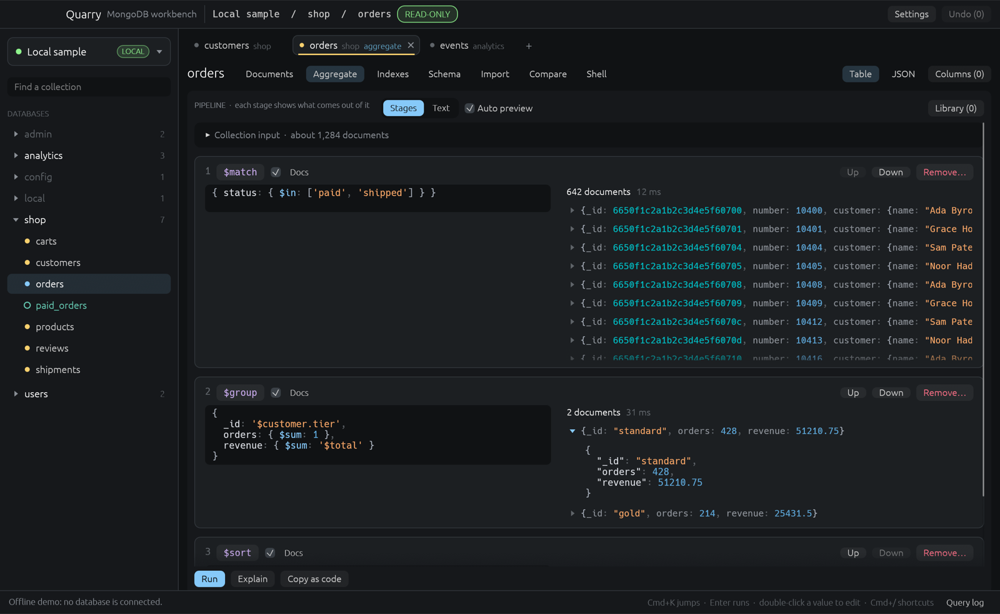
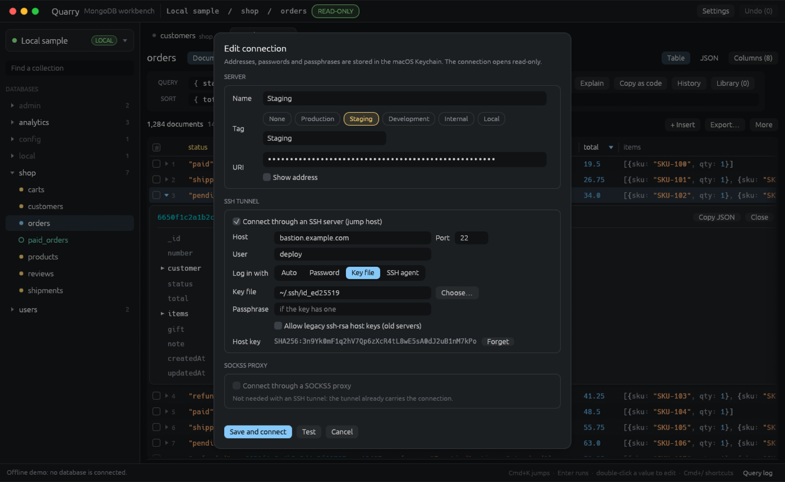

<p align="center"></p>

<h1 align="center">Quarry</h1>

<p align="center">A fast, stable and full-featured MongoDB client, written in Rust with egui.<br>Inspired by <a href="https://mingo.io">Mingo</a>.</p>



## Features

**Find your way around**
- Tabs, a table or JSON view, and columns you can pin and reorder for each collection.
- Paste `db.orders.find(...)` or `aggregate([...])` straight into the query bar.
- Type `#today` or `#last2months` instead of writing date filters by hand.
- Keep the queries you reuse in a library, and get back older ones from the history.
- Press Cmd+K to jump to any collection, and Cmd+/ to see every shortcut. On Linux and Windows, Cmd is Ctrl.

**Edit without worrying**
- Every connection opens read-only until you unlock it.
- Edits are staged, saved together, and can be undone.
- Quarry won't overwrite a change someone else made in the meantime.
- Preview the result before you update every matching document.

**See what your queries do**
- Watch a collection's inserts, updates and deletes as they happen (needs a replica set).
- Build a pipeline one stage at a time and see what comes out of each stage.
- Read the explain plan of a query or pipeline.
- Check the server's health and replica set, and find and kill slow operations (Server status, in a database's menu). It asks the server only while that window is open.
- Watch every command sent to the server, with its duration and errors, in the query log (Cmd+L).
- Copy a query or pipeline as code for the official MongoDB drivers.

**Look after your collections**
- See which indexes are used, hide one to see what happens without it, and get suggestions from slow queries.
- Create indexes with every option: unique, sparse, hidden, TTL, partial filter and collation.
- See each field's types and how often it appears, and write or generate a validator from that.
- Follow references: Quarry shows a preview next to an id and opens the document it points to. It can find these relations for you.

**Move data around**
- Import, and export to JSON, CSV or TSV.
- Compare two collections and sync the differences.
- Dump and restore with the MongoDB Database Tools. Quarry installs them if they're missing.
- Manage users and roles.

**Script it**
- A JavaScript shell running on [Bun](https://bun.sh), with the official MongoDB driver, npm packages and autocomplete. Results come back as a table.

**Connect from anywhere**
- Go through an SSH tunnel (password, key file or agent) or a SOCKS5 proxy.
- Passwords stay in your system keychain: the macOS Keychain, Windows Credential Manager, or the Secret Service on Linux.
- Tag connections as Production, Staging or anything you like, so you always know which one you're on.
- Quarry reconnects to your last connection when it starts.

| | |
|---|---|
|  |  |
|  |  |
|  |  |

## Install

Download the latest build for your system from [Releases](https://github.com/alkanna/quarry/releases).

**macOS** (Apple silicon, Intel, or universal): unzip `Quarry-macos-*.zip` into Applications. The app is not notarized, so run `xattr -dr com.apple.quarantine /Applications/Quarry.app` once.

**Linux** (x86_64 and ARM64): extract `quarry-linux-*.tar.gz` and put the `quarry` binary somewhere on your `PATH`, such as `~/.local/bin`. It needs GTK 3 and xkbcommon (`sudo apt install libgtk-3-0 libxkbcommon0` on Debian and Ubuntu), and a Secret Service provider such as GNOME Keyring or KWallet to store passwords.

**Windows** (x86_64 and ARM64): unzip `quarry-windows-*.zip` and run `quarry.exe`. The binary is not signed, so SmartScreen may warn the first time: choose More info, then Run anyway.

Quarry then updates itself: it checks for new releases shortly after launch and once a day, installs them in the background, and restarts once you have been idle for a minute with nothing unsaved. It shows what's new after an update. You can turn updates off in Settings.

## Build

Needs Rust (stable). The Shell needs [Bun](https://bun.sh), and dump/restore needs the [MongoDB Database Tools](https://www.mongodb.com/docs/database-tools/), which Quarry can install for you. Quarry finds both automatically, or you can set their paths in Settings.

```sh
cargo run --release      # run it
./bundle.sh              # package for this machine into dist/
./bundle.sh linux-x86_64 # or for a given platform (./bundle.sh --help lists them)
cargo test               # run the tests
```

`quarry --screenshot out.png` draws the offline demo, saves a picture and exits. It never connects to a database.

## Releasing

Commits to `master` follow [Conventional Commits](https://www.conventionalcommits.org) (`feat:`, `fix:`, ...). [release-please](https://github.com/googleapis/release-please) keeps a release PR open; merging it tags the version and the release workflow attaches the builds. In the repository settings, under Actions > General, allow GitHub Actions to create pull requests.

## License

MIT, see [LICENSE](LICENSE).
